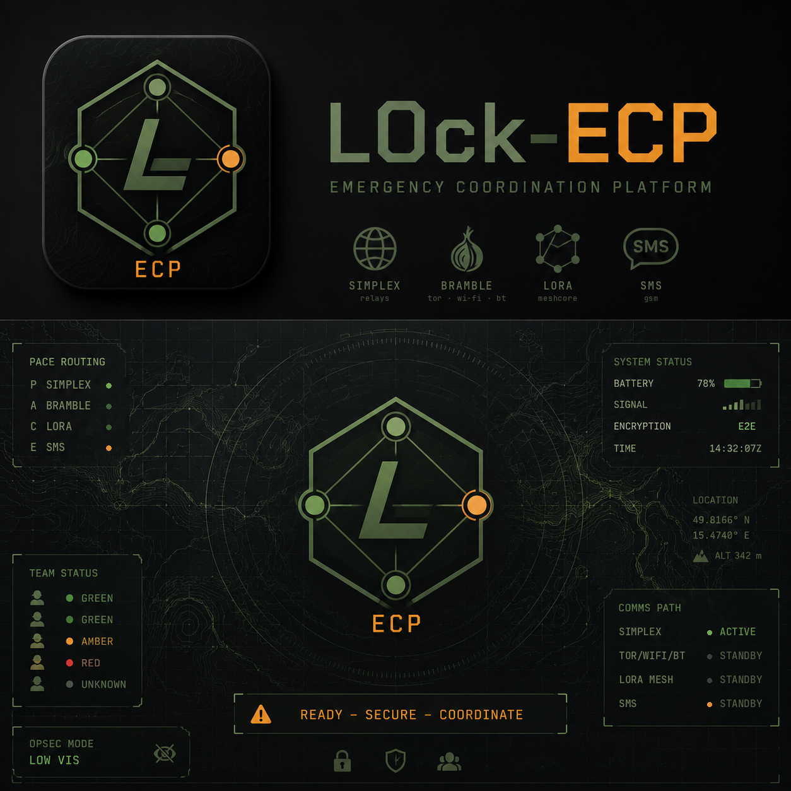

# L0ck-ECP — Emergency Coordination Platform



**[English](#english)** · **[Česky](#česky)**

## English

> **Status: testing.** The app works and has been tested on two phones, but this is a test
> build, not a stable release. Message formats may still change and the APK is signed with
> a development key.

An encrypted messenger and coordination tool for Android, built for small teams when
regular networks fail or are not available: internet and mobile outages, natural
disasters, remote areas, field events, volunteer and rescue teams.

### Download

The current test build **L0ck-ECP_v0.3.0.apk** is under [Releases](../../releases)
(Android 8.0+, arm64), with its SHA-256 checksum. From 0.3.0 the APK is signed with the
project's own key; its certificate's SHA-256 fingerprint (check with
`apksigner verify --print-certs`) is:

```
7A:19:E3:4B:A8:0B:DC:19:14:8F:B7:21:47:01:B5:79:D9:67:A0:DB:0B:21:8C:71:F8:7D:9B:F4:FE:17:A4:F0
```

Test builds up to 0.2.3 used a development key: uninstall them before installing 0.3.0
(the profile on that phone is lost; a group bundle from the base sets it up again).

### One message, several paths (PACE)

Every message is one encrypted ECP envelope. The app sends it over the first path that
works and, when no acknowledgement comes back, tries the next one by itself. Channels that
cannot work right now (no internet, radio not connected) are skipped at once. The order
can be changed in the settings.

| Layer | Channel | When it helps |
|---|---|---|
| **P** — Primary | [SimpleX](https://simplex.chat/) — relays without user identifiers | regular internet |
| **A** — Alternate | Bramble (the transport layer of [Briar](https://briarproject.org/)) — Tor, local Wi-Fi, Bluetooth | limited internet, phones close to each other |
| **C** — Contingency | LoRa via a [MeshCore](https://meshcore.io) radio (companion, e.g. Heltec V3 over Bluetooth) | no internet and no mobile network, kilometres of range, also through nearby repeaters |
| **E** — Emergency | SMS, always only after the user confirms | mobile network only |

Messages without a connection wait in a queue and go out by themselves. Each message shows
its time, delivery and read state. Public MeshCore channels are ignored.

### Features

- **Contacts** are added by scanning a QR code in person (verified) or by a link; a change
  of the own phone number (e.g. a local SIM) reaches the contacts automatically.
- **Teams:** create and join with a team QR code, team conversation, a local squad net over
  Wi-Fi/Bluetooth, a private LoRa channel, delivery to members out of range as well.
- **Voice, calls, photos and files** — only over SimpleX or Bramble by Tor/Wi-Fi, never
  Bluetooth, LoRa or SMS, and offered only while such a channel reaches the other side:
  voice messages up to 30 s (Opus) to a contact or a team; encrypted 1:1 calls (WebRTC,
  DTLS-SRTP; set up inside an ECP envelope, audio directly or through a SimpleX relay);
  photos reduced and stripped of EXIF (GPS) and files up to 512 kB from the system picker
  (no storage permission). A chat can be cleared on the phone.
- **Standardised reports:** position, STATUS (optionally with a RALLY point: place and
  time), SITREP, MEDEVAC
  9-line, SALTER (observation), 5W (who, what, where, when, why). Compact — each fits one
  LoRa packet and at most two SMS. GPS position without Google services; the receiver sees
  the coordinates, distance and bearing, and can open the point in an offline map
  (OsmAnd, Organic Maps). A report can be sent from the home screen to a team and to
  several contacts at once.
- **Group setup at the base:** an offline page on a laptop (`tools/ecp_base`) scans every
  phone's contact QR, creates the teams and shows one group bundle as a series of QR
  codes; each phone scans it and gets every contact (verified), its teams, the team's
  LoRa channel, the PACE order and its own SMS number if the base filled it in. One scan
  per phone instead of everyone scanning everyone. See
  [tools/ecp_base/README.md](tools/ecp_base/README.md); also as `L0ck-ECP-Base.zip` under
  Releases.
- **PANIC and COMPROMISED** on the PIN screen, without the PIN, while the app runs: PANIC
  sends the configured status, position and text to contacts and teams over every channel
  at once; COMPROMISED (with a confirmation elsewhere on the screen) reports "compromised"
  and destroys the profile the way the duress code does. PANIC can repeat the position
  every 5–30 min until the PIN is typed.
- **Check-in (dead man's switch):** unless you confirm within 1–24 h (a button, or
  unlocking with the PIN), the chosen status with your position goes to the PANIC
  recipients; a reminder comes 15 min before.
- **Disappearing messages** (older than 1 h – 7 days, on this phone) and an **outgoing
  queue** on the home screen (what still waits, and on which channel).
- **Security:** end-to-end encryption, encrypted storage (SQLCipher) protected by a PIN
  (Argon2id, key bound to the device), duress code, screen protection, notifications
  without content, emergency lock by four quick taps. Locking at once, after a delay or
  only by hand; optional fingerprint to return to the running profile (only with PANIC
  and COMPROMISED on, PIN again after a restart, the emergency lock or 8 hours). Factory
  reset in the settings. No accounts, no sign-up.
- **Operation:** runs in the background and with the screen locked; per-channel reconnect
  in the settings; Czech and English.

### Limitations

LoRa has little bandwidth (short messages and reports). SMS exposes metadata to the
operator. Tor adds latency, Bluetooth reaches tens of metres. The tool needs preparation
and practice before it is relied on, and it **does not replace emergency numbers (112)**
or official rescue services.

### Repository layout

| Path | Contents |
|---|---|
| `app/` | the app (Flutter, package `cz.l0ck.ecp`) |
| `packages/ecp_core/` | ECP envelope, cryptography, contact card, reports, PACE router (pure Dart) |
| `packages/ecp_meshcore/` | MeshCore companion protocol |
| `packages/ecp_simplex/` | binding to the SimpleX core (FFI / WebSocket) |
| `tools/ecp_base/` | offline base page for group setup (open `index.html` in a browser) |
| `tools/` | laptop test nodes (`ecp_peer`, `bramble-peer`) |
| `docs/ARCHITECTURE_V2.md` | design, message formats, implementation status, open questions (Czech) |
| `docs/RELEASE.md` | signing key, build tools, F-Droid notes (Czech) |

### Building

Requires Flutter 3.47+, JDK 17, Android SDK and NDK 28.

```bash
app/android/bramble/build-bramble.sh      # Bramble from Briar 1.5.24 into a local Maven repo
app/android/simplex/fetch-simplex.sh      # libsimplex.so from the official SimpleX v7.0.3 APK (verified)
cd app && dart run build_runner build      # generates database.g.dart (drift)
flutter build apk --release --target-platform android-arm64
```

The scripts keep tools and downloads in `~/.l0ck-ecp-toolchain/` (override with
`BRIAR_SRC`, `BRAMBLE_M2`, `SIMPLEX_DL`).

Tests: `cd packages/ecp_core && dart test`, `cd app && flutter test`.

### License

L0ck-ECP is free software under the **GNU Affero General Public License v3.0**
([LICENSE](LICENSE)). Whoever distributes the app, or runs a modified version of it,
must make its source code available too.

Components and their licenses:

| Component | License |
|---|---|
| [Briar / Bramble](https://code.briarproject.org/briar/briar) 1.5.24 | GPLv3 |
| [SimpleX Chat](https://github.com/simplex-chat/simplex-chat) core 7.0.3 | AGPLv3 |
| [ZXing Android Embedded](https://github.com/journeyapps/zxing-android-embedded) | Apache 2.0 |
| [flutter_webrtc](https://github.com/flutter-webrtc/flutter-webrtc) 1.6.2 with [WebRTC](https://webrtc.org) | MIT / BSD |
| [jsQR](https://github.com/cozmo/jsQR) 1.4.0 (base page) | Apache 2.0 |
| [qrcode-generator](https://github.com/kazuhikoarase/qrcode-generator) 1.4.4 (base page) | MIT |
| [SQLCipher](https://www.zetetic.net/sqlcipher/) (via `sqlite3`) | BSD-style |
| [libsodium](https://libsodium.org) (via `sodium`) | ISC |
| [Flutter](https://flutter.dev), [drift](https://drift.simonbinder.eu), `cryptography` | BSD / MIT / Apache 2.0 |

The MeshCore companion protocol is implemented in `packages/ecp_meshcore`; the
[MeshCore](https://meshcore.io) firmware runs on the radio and is not part of the app.

### Disclaimer

The app is intended for lawful use. It is not meant for breaking the laws of the country
where it is used. The author bears no responsibility for how it is used or for any damage
resulting from its use. The software is provided "as is", without warranty.

### Author

L0ckSm1thV — [GitHub](https://github.com/LocksmithV) ·
[l0cksm1thv.duckdns.org](https://l0cksm1thv.duckdns.org)

---

## Česky

> **Stav: testování.** Aplikace je funkční a ověřená na dvou telefonech, ale jde o testovací
> sestavení, ne o stabilní vydání. Formáty zpráv se ještě mohou změnit a APK je podepsané
> vývojovým klíčem.

Šifrovaný komunikátor a koordinační nástroj pro Android, určený pro malé týmy v situacích,
kdy běžná síť selhává nebo není k dispozici: výpadky internetu a mobilní sítě, živelní
pohromy, odlehlé oblasti, terénní akce, dobrovolnické a záchranné týmy.

### Stažení

Aktuální testovací sestavení **L0ck-ECP_v0.3.0.apk** je v [Releases](../../releases)
(Android 8.0+, arm64). Kontrolní součet SHA-256 je u vydání. Od verze 0.3.0 je APK
podepsané vlastním klíčem projektu; otisk certifikátu SHA-256 (ověření:
`apksigner verify --print-certs`):

```
7A:19:E3:4B:A8:0B:DC:19:14:8F:B7:21:47:01:B5:79:D9:67:A0:DB:0B:21:8C:71:F8:7D:9B:F4:FE:17:A4:F0
```

Testovací verze do 0.2.3 měly vývojový klíč: před instalací 0.3.0 je odinstaluj (profil
v telefonu zanikne; balíček skupiny ze základny ho rychle nastaví znovu).

### Jedna zpráva, víc cest (PACE)

Každá zpráva je jedna šifrovaná obálka ECP; aplikace ji pošle první cestou, která funguje,
a když nepřijde potvrzení, sama zkusí další. Kanály, které právě fungovat nemohou (bez
internetu, rádio nepřipojené), přeskočí hned. Pořadí jde v nastavení změnit.

| Vrstva | Kanál | Kdy pomůže |
|---|---|---|
| **P** — Primary | [SimpleX](https://simplex.chat/) — relé bez uživatelských identifikátorů | běžný internet |
| **A** — Alternate | Bramble (transportní vrstva [Briar](https://briarproject.org/)) — Tor, místní Wi-Fi, Bluetooth | omezený internet, telefony blízko sebe |
| **C** — Contingency | LoRa přes rádio [MeshCore](https://meshcore.io) (companion, např. Heltec V3 přes Bluetooth) | bez internetu i mobilní sítě, dosah kilometry, i přes okolní repeatery |
| **E** — Emergency | SMS, vždy až po potvrzení uživatelem | jen mobilní síť |

Zprávy bez spojení čekají ve frontě a odejdou samy. U zpráv je čas, doručení a přečtení.
Veřejné kanály MeshCore aplikace ignoruje.

### Co aplikace umí

- **Kontakty** se přidávají skenem QR osobně (ověření) nebo odkazem; změna vlastního
  telefonního čísla (např. místní SIM) se kontaktům rozešle sama.
- **Týmy:** založení a připojení přes týmové QR, týmová konverzace, místní síť skupiny
  přes Wi-Fi/Bluetooth, soukromý kanál LoRa, rozeslání i členům mimo dosah.
- **Hlas, hovory, fotky a soubory** — jen přes SimpleX nebo Bramble přes Tor/Wi-Fi, nikdy
  Bluetooth, LoRa ani SMS, a nabízené jen, když takový kanál protistranu právě dosáhne:
  hlasové zprávy do 30 s (Opus) kontaktu i týmu; šifrované hovory 1:1 (WebRTC, DTLS-SRTP;
  domluva uvnitř obálky ECP, zvuk přímo nebo přes relé SimpleX); fotky zmenšené a bez
  EXIF (GPS) a soubory do 512 kB ze systémového výběru (bez oprávnění k úložišti). Chat
  jde v telefonu vymazat.
- **Standardizovaná hlášení:** poloha, STATUS (volitelně se SRAZEM: místo a čas), SITREP,
  MEDEVAC 9-line, SALTER (pozorování), 5W (kdo, co, kde, kdy, proč). Kompaktní — vejdou se do jednoho LoRa
  paketu a nejvýš dvou SMS. Poloha z GPS bez služeb Google; příjemce vidí souřadnice,
  vzdálenost a azimut a může bod otevřít v offline mapě (OsmAnd, Organic Maps). Hlášení
  jde z úvodní obrazovky poslat týmu i více kontaktům najednou.
- **Hromadné nastavení na základně:** offline stránka na notebooku (`tools/ecp_base`)
  načte kontaktní QR všech telefonů, založí týmy a ukáže jeden balíček skupiny jako sérii
  QR kódů; každý telefon ho načte a dostane všechny kontakty (ověřené), svoje týmy, kanál
  LoRa týmu, pořadí PACE a vlastní číslo pro SMS, pokud ho základna doplnila. Jedno
  skenování na telefon místo skenování každý s každým. Viz
  [tools/ecp_base/README.md](tools/ecp_base/README.md); také jako `L0ck-ECP-Base.zip`
  v Releases.
- **PANIC a KOMPROMITOVÁN** na obrazovce PINu, bez PINu, dokud aplikace běží (PANIC může
  opakovat polohu každých 5–30 min, dokud se nezadá PIN): PANIC pošle
  nastavený stav, polohu a text kontaktům a týmům všemi kanály najednou; KOMPROMITOVÁN
  (s potvrzením na jiném místě obrazovky) ohlásí kompromitaci a zničí profil jako duress
  kód.
- **Kontrolní hlášení (dead man's switch):** když do 1–24 h nepotvrdíš, že jsi v pořádku
  (tlačítko nebo odemknutí PINem), odejde zvolený stav s polohou příjemcům PANIC;
  15 min předem připomínka.
- **Mizející zprávy** (starší než 1 h – 7 dní, v tomto telefonu) a **odchozí fronta** na
  úvodní obrazovce (co ještě čeká a kterým kanálem).
- **Bezpečnost:** šifrování end-to-end, šifrované úložiště (SQLCipher) chráněné PINem
  (Argon2id, klíč vázaný na zařízení), nouzový (duress) kód, ochrana obrazovky, oznámení
  bez obsahu, nouzové uzamčení čtyřmi rychlými klepnutími. Zamykání ihned, po zvolené
  době nebo jen ručně; volitelně otisk prstu pro návrat do běžícího profilu (jen se
  zapnutým PANIC a KOMPROMITOVÁN, PIN znovu po restartu, nouzovém zamknutí a po 8 h).
  Obnovení továrního nastavení v nastavení. Žádné účty ani registrace.
- **Provoz:** běží na pozadí i se zamčenou obrazovkou; obnovení jednotlivých kanálů
  v nastavení; čeština a angličtina.

### Omezení

LoRa má malou propustnost (krátké zprávy a hlášení). SMS prozrazuje operátorovi metadata.
Tor přidává zpoždění, Bluetooth má dosah desítek metrů. Nástroj vyžaduje přípravu
a nácvik před nasazením a **nenahrazuje tísňové linky (112)** ani oficiální záchranné
složky.

### Struktura repozitáře

| Cesta | Obsah |
|---|---|
| `app/` | aplikace (Flutter, balíček `cz.l0ck.ecp`) |
| `packages/ecp_core/` | obálka ECP, kryptografie, kontaktní karta, hlášení, PACE router (čistý Dart) |
| `packages/ecp_meshcore/` | companion protokol MeshCore |
| `packages/ecp_simplex/` | napojení na jádro SimpleX (FFI / WebSocket) |
| `tools/ecp_base/` | offline stránka základny pro hromadné nastavení (`index.html` v prohlížeči) |
| `tools/` | testovací uzly pro laptop (`ecp_peer`, `bramble-peer`) |
| `docs/ARCHITECTURE_V2.md` | návrh, formáty zpráv, stav implementace, otevřené otázky |
| `docs/RELEASE.md` | podpisový klíč, nástroje sestavení, poznámky k F-Droid |

### Sestavení

Potřeba: Flutter 3.47+, JDK 17, Android SDK a NDK 28.

```bash
app/android/bramble/build-bramble.sh      # Bramble z Briar 1.5.24 do lokálního Mavenu
app/android/simplex/fetch-simplex.sh      # libsimplex.so z oficiálního APK SimpleX v7.0.3 (ověřeno)
cd app && dart run build_runner build      # vygeneruje database.g.dart (drift)
flutter build apk --release --target-platform android-arm64
```

Skripty ukládají nástroje a stažené soubory do `~/.l0ck-ecp-toolchain/` (jiné místo:
proměnné `BRIAR_SRC`, `BRAMBLE_M2`, `SIMPLEX_DL`).

Testy: `cd packages/ecp_core && dart test`, `cd app && flutter test`.

### Licence

L0ck-ECP je svobodný software pod licencí **GNU Affero General Public License v3.0**
([LICENSE](LICENSE)). Kdo aplikaci šíří nebo provozuje upravenou, musí zpřístupnit i její
zdrojový kód.

Použité komponenty a jejich licence:

| Komponenta | Licence |
|---|---|
| [Briar / Bramble](https://code.briarproject.org/briar/briar) 1.5.24 | GPLv3 |
| [SimpleX Chat](https://github.com/simplex-chat/simplex-chat) core 7.0.3 | AGPLv3 |
| [ZXing Android Embedded](https://github.com/journeyapps/zxing-android-embedded) | Apache 2.0 |
| [flutter_webrtc](https://github.com/flutter-webrtc/flutter-webrtc) 1.6.2 s [WebRTC](https://webrtc.org) | MIT / BSD |
| [jsQR](https://github.com/cozmo/jsQR) 1.4.0 (stránka základny) | Apache 2.0 |
| [qrcode-generator](https://github.com/kazuhikoarase/qrcode-generator) 1.4.4 (stránka základny) | MIT |
| [SQLCipher](https://www.zetetic.net/sqlcipher/) (přes `sqlite3`) | BSD-style |
| [libsodium](https://libsodium.org) (přes `sodium`) | ISC |
| [Flutter](https://flutter.dev), [drift](https://drift.simonbinder.eu), `cryptography` | BSD / MIT / Apache 2.0 |

Protokol companion rádia MeshCore je implementovaný v `packages/ecp_meshcore`; firmware
[MeshCore](https://meshcore.io) běží v rádiu a není součástí aplikace.

### Upozornění

Aplikace je určená k zákonnému použití. Není určená k porušování zákonů země, kde se
používá. Autor nenese odpovědnost za způsob jejího použití ani za škody z něj vzniklé.
Software je poskytován „tak, jak je“, bez záruky.
