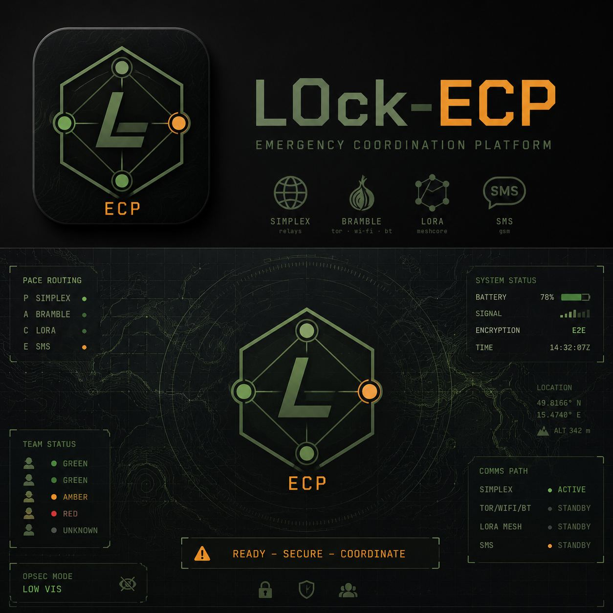

# L0ck-ECP Base — group setup

**[English](#english)** · **[Česky](#česky)**

## English

An offline web page for a laptop at the base. It scans the contact QR codes of every
phone, sets up the teams, and shows one **group bundle** as a series of QR codes. Each
phone scans the bundle in the L0ck-ECP app and is set up in one go. For ten people that
is one scan per phone instead of about ninety mutual scans.

> **Status: testing**, like the app. Use it together with L0ck-ECP 0.2.3 or newer.

### What a phone gets from the bundle

- every other member as a **verified contact** (the base saw each phone in person),
- the **teams** it is ticked in, with their members,
- the private **LoRa channel** of the chosen team (members of that team only),
- the **PACE order**, if set,
- its **own SMS number**, if it was typed in or corrected at the base.

### Features

- **Camera scanning** with an aiming square. A red **SCANNING** panel while it looks,
  a green **READ** panel with a tone once a QR is read. Nothing is added automatically:
  check the card and press **Add**, or **Again** to scan once more.
- **Name and number** can be corrected before adding, and later with **Edit** in the list.
  The rest of the card (keys, SimpleX and Bramble addresses) stays as the phone made it.
- **QR** in the list shows a member's contact card (with the changes) for scanning as an
  ordinary contact. **Delete** removes the member and their team ticks.
- **Teams:** any number, each with a new random key; tick who belongs where; one team's
  LoRa channel for the radios.
- **PACE order:** optionally the same channel order for everyone.
- **Bundle:** split into QR codes of 700 B, shown one by one or cycling every 3 s
  (arrow keys work too). Phones read the parts in any order.
- Links can be pasted instead of scanned. Czech and English (CZ | EN switch).
- Step overview at the top: what is done and what is next.

### Use

1. Open `tools/ecp_base/index.html` in a browser (Chrome, Chromium, Firefox). No internet
   is needed. If the browser refuses the camera for a file from disk, run
   `python3 -m http.server 8741 --bind 127.0.0.1` in the repository root and open
   `http://127.0.0.1:8741/tools/ecp_base/`.
2. **Members:** start the camera; on each phone open *My contact*, hold it in the square,
   check the name and number, **Add**.
3. **Teams:** add teams, tick the members, choose the *LoRa channel* for one of them.
4. **PACE order:** optional.
5. **Make the bundle.** On each phone: *Contacts* or *Teams* → scanner icon → *Load group
   bundle* → *Scan QR*. The scanner reopens by itself until every part is read. Then
   *Set up this phone*.
6. When every phone is set up, **Erase all** (or close the tab).

A phone whose card is not in the bundle is not set up. After any change, make the bundle
again.

### Security

- **Offline and nothing stored.** No server, no account, no browser storage. Everything
  lives in the open tab's memory; *Erase all* or closing the tab forgets it. A
  Content-Security-Policy `connect-src 'none'` stops the page from sending anything.
- **Team keys** (32 random bytes each) are made in the browser with
  `crypto.getRandomValues`. The base never sees any private key: a contact card holds only
  public keys and addresses.
- **The bundle carries every team's key.** Whoever photographs it can read those teams'
  traffic. Show it only at the base, in person, and erase it afterwards. A phone keeps
  only the keys of its own teams.
- **Verified contacts:** the phones trust the bundle as if each card had been scanned in
  person, so the base page must run on a laptop you control.
- **Third-party code** is two QR libraries, vendored and pinned: their SHA-256 sums are in
  `vendor/SHA256SUMS` (checked against the npm registry when added). Nothing is loaded
  from the internet.
- The bundle format matches `packages/ecp_core/lib/src/group_bundle.dart`; a test decodes
  a bundle made by this page with the app's code.

### Files

| File | Contents |
|---|---|
| `index.html`, `base.js` | the page |
| `bundle.js` | the bundle and card format (same as `group_bundle.dart`) |
| `img/` | logo and background (JPEG copy of `docs/images/L0ck-ECP_background.png`) |
| `vendor/jsQR.js` | QR reading, [jsQR](https://github.com/cozmo/jsQR) 1.4.0, Apache 2.0 (`jsQR.LICENSE`) |
| `vendor/qrcode.js` | QR drawing, [qrcode-generator](https://github.com/kazuhikoarase/qrcode-generator) 1.4.4, MIT (licence in the file header) |
| `vendor/SHA256SUMS` | checksums of the two libraries |
| `test/bundle_test.js` | encoder test; `--write` refreshes the fixture for the Dart test |

Tests: `node tools/ecp_base/test/bundle_test.js` and `cd packages/ecp_core && dart test`.

### Licence and author

Part of L0ck-ECP, free software under the GNU Affero General Public License v3.0
([LICENSE](../../LICENSE)).

Author: **L0ckSm1thV** — [GitHub](https://github.com/LocksmithV) ·
[l0cksm1thv.duckdns.org](https://l0cksm1thv.duckdns.org)

---

## Česky

Offline webová stránka pro notebook na základně. Načte kontaktní QR všech telefonů,
založí týmy a ukáže jeden **balíček skupiny** jako sérii QR kódů. Každý telefon ho načte
v aplikaci L0ck-ECP a nastaví se najednou. Pro deset lidí je to jedno skenování na
telefon místo zhruba devadesáti vzájemných.

> **Stav: testování**, stejně jako aplikace. Používej s L0ck-ECP 0.2.3 nebo novější.

### Co telefon z balíčku dostane

- všechny ostatní členy jako **ověřené kontakty** (základna viděla každý telefon osobně),
- **týmy**, ve kterých je zaškrtnutý, i s jejich členy,
- soukromý **kanál LoRa** zvoleného týmu (jen členové toho týmu),
- **pořadí PACE**, pokud je zapnuté,
- **vlastní číslo pro SMS**, pokud ho základna doplnila nebo opravila.

### Funkce

- **Skenování kamerou** se zaměřovacím čtvercem. Při hledání červený panel **HLEDÁM QR**,
  po načtení zelený **NAČTENO** a zvukový signál. Nic se nepřidá samo: zkontroluj kartu
  a dej **Přidat**, nebo **Znovu**.
- **Jméno a číslo** jde opravit před přidáním i později přes **Upravit** v seznamu. Zbytek
  karty (klíče, adresy SimpleX a Bramble) zůstává, jak ho vytvořil telefon.
- **QR** v seznamu ukáže kontaktní kartu člena (i s úpravami), telefon ji načte jako běžný
  kontakt. **Smazat** odebere člena i jeho zaškrtnutí v týmech.
- **Týmy:** libovolný počet, každý s novým náhodným klíčem; zaškrtnutí členů; kanál LoRa
  jednoho týmu pro rádia.
- **Pořadí PACE:** volitelně stejné pořadí kanálů pro všechny.
- **Balíček:** rozdělený do QR po 700 B, ukazovaných po jednom nebo střídaných po 3 s
  (fungují i šipky). Telefony čtou díly v libovolném pořadí.
- Odkazy jde i vložit místo skenování. Čeština a angličtina (přepínač CZ | EN).
- Nahoře přehled kroků: co je hotové a co zbývá.

### Použití

1. Otevři `tools/ecp_base/index.html` v prohlížeči (Chrome, Chromium, Firefox). Internet
   není potřeba. Když prohlížeč u souboru z disku nepovolí kameru, spusť v kořeni
   repozitáře `python3 -m http.server 8741 --bind 127.0.0.1` a otevři
   `http://127.0.0.1:8741/tools/ecp_base/`.
2. **Členové:** zapni kameru; na každém telefonu otevři *Můj kontakt*, podrž ho ve
   čtverci, zkontroluj jméno a číslo, **Přidat**.
3. **Týmy:** přidej týmy, zaškrtni členy, u jednoho zvol *Kanál LoRa*.
4. **Pořadí PACE:** volitelně.
5. **Vytvořit balíček.** Na každém telefonu: *Kontakty* nebo *Týmy* → ikona skeneru →
   *Načíst balíček skupiny* → *Skenovat QR*. Skener se sám otevírá znovu, dokud nejsou
   načtené všechny díly. Pak *Nastavit telefon*.
6. Po nastavení všech telefonů **Smazat vše** (nebo zavři kartu).

Telefon, jehož karta v balíčku není, se nenastaví. Po každé změně je potřeba balíček
vytvořit znovu.

### Bezpečnost

- **Offline a nic neukládá.** Žádný server, účet ani úložiště prohlížeče. Všechno je jen
  v paměti otevřené karty; *Smazat vše* nebo zavření karty to zapomene. Content-Security-
  Policy `connect-src 'none'` stránce nedovolí nic odeslat.
- **Klíče týmů** (každý 32 náhodných bajtů) vznikají v prohlížeči přes
  `crypto.getRandomValues`. Základna nevidí žádný soukromý klíč: kontaktní karta nese jen
  veřejné klíče a adresy.
- **Balíček nese klíče všech týmů.** Kdo si ho vyfotí, čte provoz těch týmů. Ukazuj ho
  jen na základně, osobně, a pak ho smaž. Telefon si ponechá jen klíče svých týmů.
- **Ověřené kontakty:** telefony balíčku věří, jako by každou kartu načetly osobně, proto
  stránku spouštěj jen na notebooku, který máš pod kontrolou.
- **Cizí kód** jsou dvě knihovny pro QR, přibalené a pevně dané verze: jejich SHA-256 je
  ve `vendor/SHA256SUMS` (při přidání ověřené proti registru npm). Nic se nenačítá
  z internetu.
- Formát balíčku odpovídá `packages/ecp_core/lib/src/group_bundle.dart`; test dekóduje
  balíček vytvořený touto stránkou kódem aplikace.

### Soubory

| Soubor | Obsah |
|---|---|
| `index.html`, `base.js` | stránka |
| `bundle.js` | formát balíčku a karty (stejný jako `group_bundle.dart`) |
| `img/` | logo a pozadí (kopie `docs/images/L0ck-ECP_background.png` v JPEG) |
| `vendor/jsQR.js` | čtení QR, [jsQR](https://github.com/cozmo/jsQR) 1.4.0, Apache 2.0 (`jsQR.LICENSE`) |
| `vendor/qrcode.js` | kreslení QR, [qrcode-generator](https://github.com/kazuhikoarase/qrcode-generator) 1.4.4, MIT (licence v hlavičce souboru) |
| `vendor/SHA256SUMS` | kontrolní součty obou knihoven |
| `test/bundle_test.js` | test kodéru; `--write` obnoví fixture pro test v Dartu |

Testy: `node tools/ecp_base/test/bundle_test.js` a `cd packages/ecp_core && dart test`.

### Licence a autor

Součást L0ck-ECP, svobodný software pod licencí GNU Affero General Public License v3.0
([LICENSE](../../LICENSE)).

Autor: **L0ckSm1thV** — [GitHub](https://github.com/LocksmithV) ·
[l0cksm1thv.duckdns.org](https://l0cksm1thv.duckdns.org)
